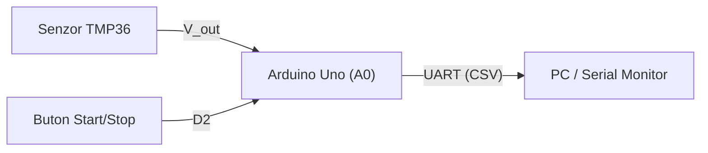

## Author 

Pavel Constantin-Beniamin 4LF342

# APD – Laborator 

Proiect de laborator pentru disciplina Achiziția și prelucrarea datelor. Nod de achiziție a temperaturii bazat pe Arduino Uno.

# Hardware

Arduino Uno R3, senzor de temperatură TMP36Platformă: Arduino Uno R3 (ATmega328P)
Autor laborator: <numele vostru>

## Parametri
- `SENSOR_PIN`: intrarea analogică a senzorului (A0)
- `SAMPLE_PERIOD_MS`: perioada de eșantionare în milisecunde (1000 ms)
- `SERIAL_BAUD`: viteza de transmisie a portului serial (9600 baud)
- `LED_PIN`: pinul digital pentru LED-ul de stare (13)
- `BUTTON_PIN`: pinul digital pentru butonul de control (2)

Comunicație serială: suportă 115200 baud pentru viteză mare de transfer sau 19200 baud pentru compatibilitate cu echipamente vechi.


# Sistem de achiziție și monitorizare a temperaturii (APD)

Proiect de laborator pentru achiziția semnalelor analogice, filtrarea numerică și transmiterea datelor pe interfața serială UART.

## 1. Arhitectura sistemului



## 2. Alocarea pinilor (Pinout)

| Componentă | Pin Arduino | Configurație | Rol |
| :--- | :---: | :---: | :--- |
| Senzor TMP36 | `A0` | Intrare analogică | Măsurare temperatură |
| Buton control | `D2` | `INPUT_PULLUP` | Activare / oprire eșantionare |
| LED Stare | `D13` | `OUTPUT` | Semnalizare achiziție activă |

## 3. Relația de conversie

Pentru senzorul TMP36 ($500\text{ mV}$ offset la $0^\circ\text{C}$, pantă $10\text{ mV}/^\circ\text{C}$), temperatura în grade Celsius se calculează cu relația:

$$T(^\circ\text{C}) = \left( \frac{D_{ADC} \cdot 5.0}{1023.0} - 0.5 \right) \cdot 100$$

### Filtrarea numerică

Pentru atenuarea zgomotului de măsură se utilizează un filtru de medie mobilă (Moving Average Filter). Ecuația mediei aritmetice pentru $M$ eșantioane este:

$$y[n] = \frac{1}{M} \sum_{k=0}^{M-1} x[n-k]$$

Implementarea buclei de calcul în C++:

```cpp
float computeMovingAverage(const float x[], int M) {
    float sum = 0.0f;
    for (int k = 0; k < M; k++) {
        sum += x[k];
    }
    return sum / (float)M;
}
```

## 4. Formatul datelor transmise (CSV)

```text
timestamp_ms,raw_adc,voltage_v,temp_c
1000,153,0.75,24.78
2000,155,0.76,25.76
```

Pentru detalii despre fluxul de comunicație și comenzi, consultați [Specificația protocolului](docs/protocol.md).

## 5. Checklist verificare

- [x] Configurare repository și `.gitignore`
- [x] Redactare specificație hardware în Markdown
- [ ] Simulare circuit în Tinkercad Circuits