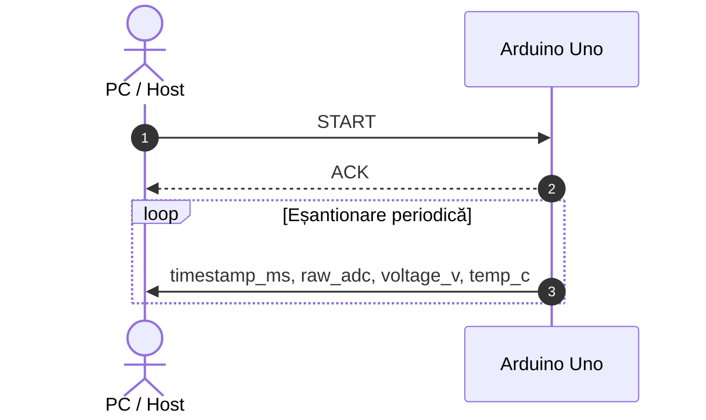
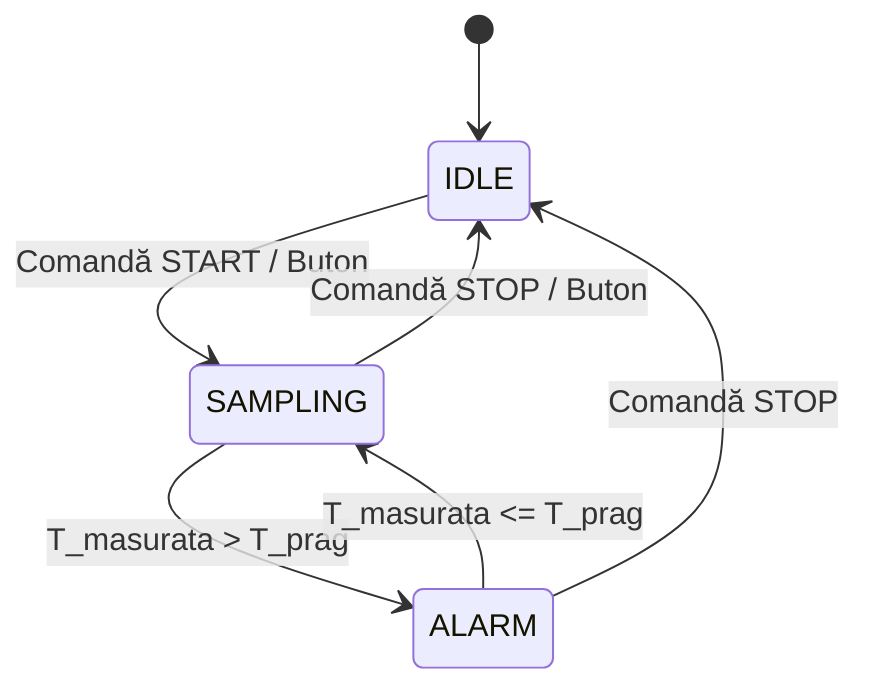

# Protocol de comunicație serială

## 1. Diagramă de secvență

## 2. Comenzi suportate

| Comandă | Cod / Format | Efect produs |
| :--- | :---: | :--- |
| `START` | `START` / `0x01` | Inițiază achiziția periodică și transmiterea eșantioanelor pe interfața serială |
| `STOP` | `STOP` / `0x02` | Oprește procesul de achiziție și transmitere a datelor |
| `STATUS` | `STATUS` / `0x03` | Răspunde cu starea curentă a modulului de achiziție și configurarea activă |

## 3. Diagramă de stări (Automat de achiziție)

